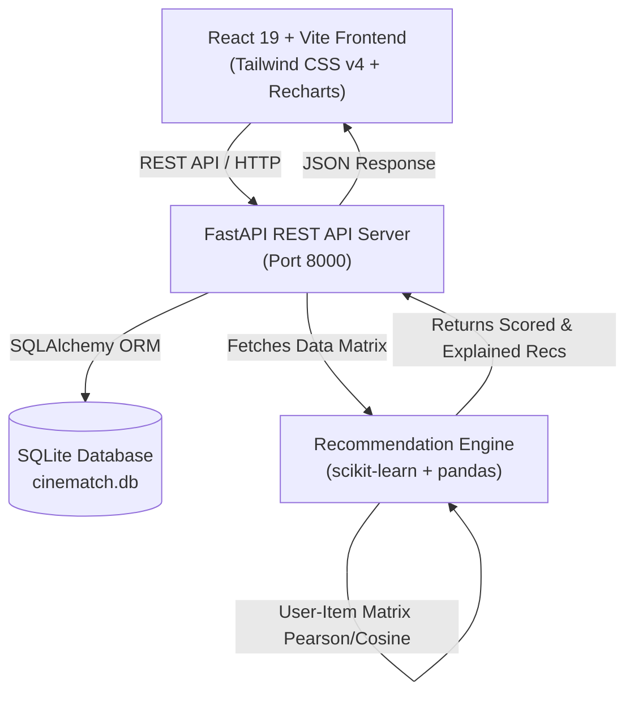
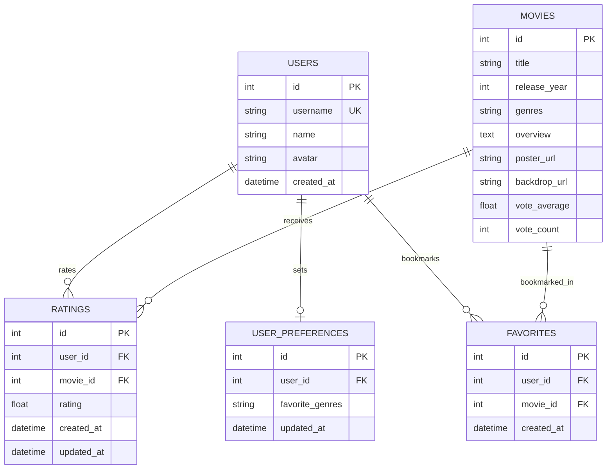

# CineMatch — AI-Powered Movie Recommendation System

[](https://fastapi.tiangolo.com/)
[](https://react.dev/)
[](https://tailwindcss.com/)
[](https://scikit-learn.org/)
[](https://www.sqlite.org/)
[](https://docs.pytest.org/)

**CineMatch** is a full-stack, machine learning-powered movie recommendation platform designed to deliver transparent, highly personalized film suggestions. Built with a **FastAPI** Python backend, a cinematic **React + Vite** frontend, and **scikit-learn** algorithms, CineMatch blends **Content-Based Filtering**, **Collaborative Filtering**, and **Hybrid AI** architectures with explainable AI rationales.

---

## Table of Contents

- [Key Features](#key-features)
- [System Architecture](#system-architecture)
- [Recommendation Algorithms](#recommendation-algorithms)
  - [1. Content-Based Filtering](#1-content-based-filtering)
  - [2. Collaborative Filtering](#2-collaborative-filtering)
  - [3. Hybrid Scoring Architecture](#3-hybrid-scoring-architecture)
  - [4. Explainable AI Rationales](#4-explainable-ai-rationales)
- [Technology Stack](#technology-stack)
- [Database Schema](#database-schema)
- [Dataset & Seeding](#dataset--seeding)
- [Quick Start Guide](#quick-start-guide)
  - [Prerequisites](#prerequisites)
  - [Backend Setup](#1-backend-setup)
  - [Frontend Setup](#2-frontend-setup)
- [Running Automated Tests](#running-automated-tests)
- [API Documentation](#api-documentation)
- [Interactive Demo Personas](#interactive-demo-personas)
- [Known Limitations & Future Enhancements](#known-limitations--future-enhancements)

---

## Key Features

- **Personalized Discovery Dashboard**:
  - Hero banner with quick title search, genre tags, and featured movie spotlight.
  - Dynamic **"Recommended for You"** feed generated by real-time ML models.
  - Model switcher allowing users to toggle between **Hybrid**, **Content-Based**, and **Collaborative** recommendation views.
- **Explainable Recommendations**:
  - Every recommended film presents a mathematical rationale (e.g., *"Matched via Hybrid AI: Loved by peer viewers and aligns with your favorite genre elements"* or *"Matches your tastes for movies you rated highly: Inception (5.0★)"*).
- **Interactive 1-5 Star Ratings & Watchlist**:
  - Rate any movie from 1 to 5 stars with live hover preview.
  - Bookmark movies to a personal **Favorites** list with 1-click toggles.
  - Edit or delete ratings with instant recommendation engine recalibration.
- **Item-to-Item Similar Movies**:
  - Explore films similar to any selected movie, calculated via cosine similarity over genre and storyline TF-IDF vectors.
- **Deep Search & Multi-Dimensional Filters**:
  - Search by movie title in real time.
  - Filter by genre, release year, and minimum rating (e.g. 8.0+ Acclaimed).
  - Sort by popularity, rating, release year, or title (A-Z).
- **Interactive Ratings Visualizer**:
  - Built-in **Recharts** charts showing 1-5 star score distribution and a horizontal bar chart of the user's most rated genres.
- **Multi-Persona Demo Switcher**:
  - Switch between curated personas (**Alex** - Sci-Fi fan, **Sarah** - Romance/Drama lover, **Marcus** - Crime/Thriller fan, **Elena** - Animation lover, **Jordan** - Sci-Fi peer, **Newbie** - Cold start user) or create a custom profile.
- **Genre Onboarding / Preferences Modal**:
  - Select favorite genres anytime to recalibrate recommendations even before submitting ratings.

---

## System Architecture



---

## Recommendation Algorithms

The core recommendation logic is implemented in [`backend/recommendation_engine.py`](file:///c:/Users/DELL/Desktop/BingeWatch/backend/recommendation_engine.py).

### 1. Content-Based Filtering
- **Feature Extraction**: Movie genres and plot descriptions are combined and vectorized using **TF-IDF (Term Frequency-Inverse Document Frequency)** with unigram and bigram tokenization and English stop-word filtering. Genres are prioritized using term weighting.
- **User Profile Modeling**:
  - For rated movies: Generates a normalized user preference vector by calculating the weighted average of the TF-IDF vectors of movies rated $\ge 3.5\star$, scaled linearly by score.
  - For explicit genre preferences: Blends the user profile vector with the TF-IDF representation of the user's selected genres (70% rating profile / 30% explicit preferences).
- **Scoring**: Computes cosine similarity between the user profile vector and all candidate movie vectors:
  $$\text{Cosine Similarity}(\vec{u}, \vec{m}) = \frac{\vec{u} \cdot \vec{m}}{\|\vec{u}\| \|\vec{m}\|}$$
- Excludes movies already rated by the user.

### 2. Collaborative Filtering
- **User-Item Matrix**: Constructs a sparse matrix $R \in \mathbb{R}^{U \times M}$ where rows represent users and columns represent movie ratings.
- **User Similarity**: Mean-centers user ratings to neutralize individual rating bias, then calculates cosine similarity between the target user and all peer users.
- **Neighborhood Selection**: Selects the top $k$ nearest peer users with positive similarity coefficients ($\text{sim} > 0.05$).
- **Rating Prediction**: Computes the predicted rating for candidate movies:
  $$\hat{r}_{u, i} = \frac{\sum_{v \in \text{Peers}} \text{sim}(u, v) \cdot r_{v, i}}{\sum_{v \in \text{Peers}} \text{sim}(u, v)}$$
- **Graceful Fallback**: If the user has fewer than 2 ratings or no similar peers are found, automatically falls back to Content-Based recommendations.

### 3. Hybrid Scoring Architecture
Combines Content-Based ($S_{\text{CB}}$) and Collaborative Filtering ($S_{\text{CF}}$) normalized scores via dynamic weighting:
$$\text{Score}_{\text{Hybrid}} = w_{\text{CB}} \cdot S_{\text{CB}} + w_{\text{CF}} \cdot S_{\text{CF}}$$
- **Dynamic Weight Adaptation**:
  - $< 5$ ratings: $w_{\text{CB}} = 0.65, w_{\text{CF}} = 0.35$ (relies more on content characteristics).
  - $5-9$ ratings: $w_{\text{CB}} = 0.50, w_{\text{CF}} = 0.50$ (balanced hybrid).
  - $\ge 10$ ratings: $w_{\text{CB}} = 0.35, w_{\text{CF}} = 0.65$ (collaborative community wisdom dominates).

### 4. Explainable AI Rationales
Rather than displaying opaque numbers or generic copy, the engine inspects the contributing mathematical signals:
- **Shared high ratings**: Highlights specific movies the user loved (e.g. *"Matches your tastes for movies you rated highly: Inception (5.0★)"*).
- **Collaborative peer consensus**: Discloses peer community overlap (e.g. *"Users with similar taste to yours (2 members) rated this movie highly"*).
- **Genre affinity**: Cites explicit favorite genres selected during onboarding.

---

## Technology Stack

| Layer | Technologies |
|---|---|
| **Frontend** | React 19, Vite 6, Tailwind CSS v4, Lucide React, Recharts |
| **Backend** | Python 3.10+, FastAPI, Uvicorn, Pydantic v2, SQLAlchemy 2.0 |
| **Machine Learning** | scikit-learn, pandas, NumPy, SciPy |
| **Database** | SQLite 3 (persisted locally in `backend/cinematch.db`) |
| **Testing** | Pytest, FastAPI TestClient, httpx |

---

## Database Schema



---

## Dataset & Seeding

The application automatically seeds the SQLite database on its first startup with **60+ globally recognized movies** spanning all major genres (Sci-Fi, Action, Thriller, Drama, Romance, Comedy, Animation, Crime, Adventure, Fantasy, Horror, Mystery).

Each movie includes:
- Accurate release year and multi-genre tags.
- High-resolution movie posters and backdrop images from official TMDB CDNs.
- Full plot overviews and global average ratings.
- Seed ratings from multiple distinct user personas to allow immediate testing of Collaborative Filtering and Hybrid recommendations.

### MovieLens Dataset Support
The application also includes a dedicated dataset loader in [`backend/data_loader.py`](file:///c:/Users/DELL/Desktop/BingeWatch/backend/data_loader.py):
```python
from data_loader import import_movielens_csv

# Imports standard MovieLens 'movies.csv' and 'ratings.csv'
import_movielens_csv(db, "path/to/movies.csv", "path/to/ratings.csv", max_movies=500)
```

---

## Quick Start Guide

### Prerequisites
- **Python 3.10+** (tested and verified up to Python 3.14)
- **Node.js 18+** and **npm**

---

### 1. Backend Setup

1. Open a terminal and navigate to the `backend` directory:
   ```bash
   cd backend
   ```

2. (Optional) Create and activate a Python virtual environment:
   ```bash
   # Windows PowerShell:
   python -m venv venv
   .\venv\Scripts\Activate.ps1

   # macOS / Linux:
   python3 -m venv venv
   source venv/bin/activate
   ```

3. Install backend dependencies:
   ```bash
   pip install -r requirements.txt
   ```

4. Start the FastAPI development server:
   ```bash
   python -m uvicorn main:app --host 127.0.0.1 --port 8000 --reload
   ```

   The backend will automatically initialize the database and seed it on first launch.
   - **API Base URL**: `http://127.0.0.1:8000`
   - **Interactive Swagger Docs**: `http://127.0.0.1:8000/docs`

---

### 2. Frontend Setup

1. In a second terminal, navigate to the `frontend` directory:
   ```bash
   cd frontend
   ```

2. Install npm dependencies:
   ```bash
   npm install
   ```

3. Start the Vite development server:
   ```bash
   npm run dev
   ```

4. Open your browser and navigate to:
   ```
   http://127.0.0.1:5173
   ```

---

## Running Automated Tests

A comprehensive test suite of 17 automated tests is located in [`backend/tests`](file:///c:/Users/DELL/Desktop/BingeWatch/backend/tests), covering recommendation correctness, collaborative filtering behavior, hybrid ranking, cold-start edge cases, rating CRUD, favorites, and error handling.

To run the automated tests:

```bash
# From the project root:
python -m pytest backend/tests -v
```

**Test Coverage Summary**:
```text
backend/tests/test_api.py::test_list_movies_pagination PASSED
backend/tests/test_api.py::test_search_movies PASSED
backend/tests/test_api.py::test_get_movie_details PASSED
backend/tests/test_api.py::test_get_movie_404 PASSED
backend/tests/test_api.py::test_get_genres PASSED
backend/tests/test_api.py::test_rating_crud_flow PASSED
backend/tests/test_api.py::test_favorites_crud_flow PASSED
backend/tests/test_api.py::test_user_preferences_flow PASSED
backend/tests/test_api.py::test_recommendations_endpoint PASSED
backend/tests/test_api.py::test_similar_movies_endpoint PASSED
backend/tests/test_api.py::test_user_stats_endpoint PASSED
backend/tests/test_recommendation_engine.py::test_similar_movies_computation PASSED
backend/tests/test_recommendation_engine.py::test_content_based_recommendations_alex PASSED
backend/tests/test_recommendation_engine.py::test_collaborative_filtering_recommendations PASSED
backend/tests/test_recommendation_engine.py::test_hybrid_recommendation_ranking PASSED
backend/tests/test_recommendation_engine.py::test_new_user_cold_start PASSED
backend/tests/test_recommendation_engine.py::test_empty_dataset_handling PASSED
====================== 17 passed in 9.19s =======================
```

---

## API Documentation

All endpoints are self-documented via FastAPI's interactive OpenAPI UI at `http://127.0.0.1:8000/docs`.

| Method | Endpoint | Description |
|---|---|---|
| `GET` | `/api/movies` | List movies with pagination, genre, year, and min-rating filters |
| `GET` | `/api/movies/{movie_id}` | Retrieve details for a specific movie |
| `GET` | `/api/movies/search?q={query}` | Search movies by title with partial matching |
| `GET` | `/api/genres` | List all unique movie genres in catalog |
| `POST` | `/api/preferences` | Save or update a user's favorite genres |
| `GET` | `/api/preferences/{user_id}` | Retrieve saved genre preferences for a user |
| `POST` | `/api/ratings` | Create or update a 1-5 star movie rating |
| `GET` | `/api/ratings/{user_id}` | Retrieve all ratings submitted by a user |
| `DELETE` | `/api/ratings/{user_id}/{movie_id}` | Remove a movie rating |
| `GET` | `/api/favorites/{user_id}` | Retrieve a user's bookmarked favorite movies |
| `POST` | `/api/favorites` | Add a movie to favorites |
| `DELETE` | `/api/favorites/{user_id}/{movie_id}` | Remove a movie from favorites |
| `GET` | `/api/recommendations/{user_id}` | Personalized recommendations (`method=hybrid\|content\|collaborative`) |
| `GET` | `/api/recommendations/{user_id}/similar/{movie_id}` | Retrieve similar movies based on content similarity |
| `GET` | `/api/stats/{user_id}` | Rating distribution (1-5 stars) and top genres for Recharts charts |
| `GET` | `/api/users` | List demo user profiles |
| `POST` | `/api/users` | Create a custom user profile |
| `POST` | `/api/reset-data` | Reset database to default demo state |

---

## Interactive Demo Personas

The application includes pre-configured demo user profiles to test recommendation dynamics instantly via the user switcher in the top right:

| Persona | Name | Taste Profile | What to Expect in Recommendations |
|---|---|---|---|
| **User 1** | Alex Rivera | Sci-Fi, Action, Thriller | High ranking for *Dune: Part Two*, *The Prestige*, *Ex Machina* |
| **User 2** | Sarah Chen | Romance, Drama, Comedy | High ranking for *The Truman Show*, *Parasite*, *Amélie* |
| **User 3** | Marcus Brody | Crime, Mystery, Thriller | High ranking for *Goodfellas*, *No Country for Old Men*, *Se7en* |
| **User 4** | Elena Rostova | Animation, Family, Fantasy | High ranking for *Spider-Man: Across the Spider-Verse*, *WALL-E*, *Up* |
| **User 5** | Jordan Taylor | Sci-Fi, Action (Peer of Alex) | Collaborative filtering partner for Alex |
| **User 6** | New Explorer | Cold-Start (0 ratings) | Prompts genre selection, falling back gracefully to popularity |

---

## Known Limitations & Future Enhancements

- **Matrix Factorization (SVD / TruncatedSVD)**: The current collaborative filtering implementation uses user-based k-nearest neighbors cosine similarity. Implementing matrix factorization (e.g. SVD or LightFM) would improve scalability for datasets with over $100,000$ users.
- **Deep Learning Embeddings**: Incorporating pre-trained sentence transformer embeddings (e.g., `all-MiniLM-L6-v2`) on movie overviews would capture even deeper semantic nuance than TF-IDF.
- **Authentication**: Designed intentionally as a friction-free student demo with local user switching; OAuth2 / JWT authentication can be layered in for multi-tenant production deployments.

---

## License

MIT License — free to use, modify, and extend for educational and academic purposes.
